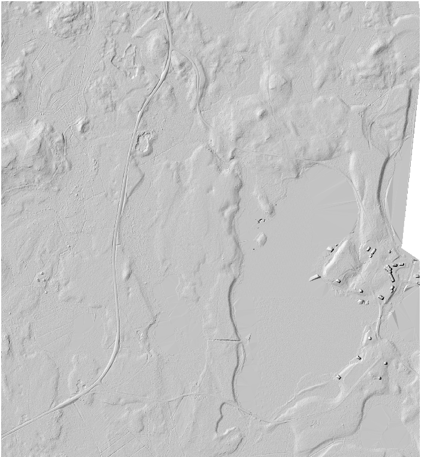
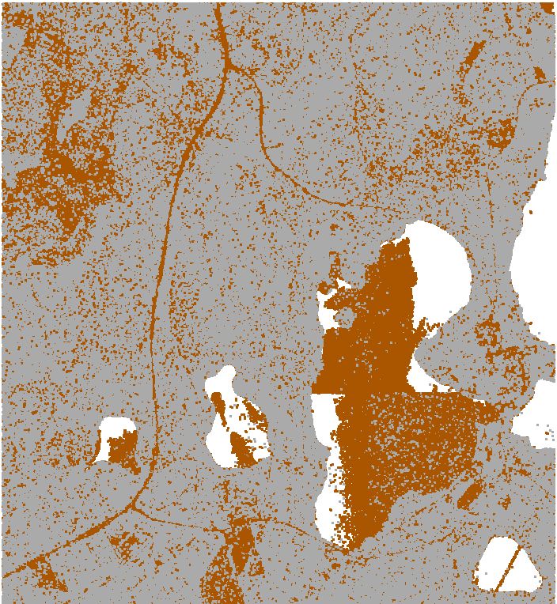
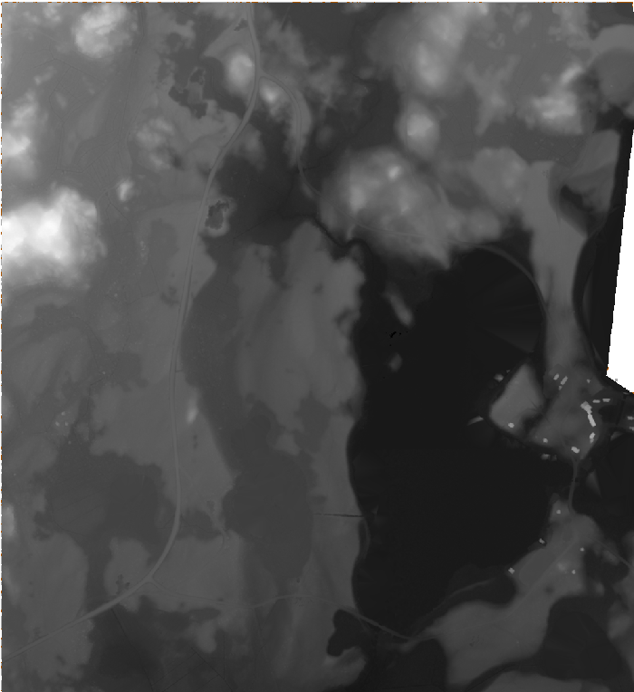
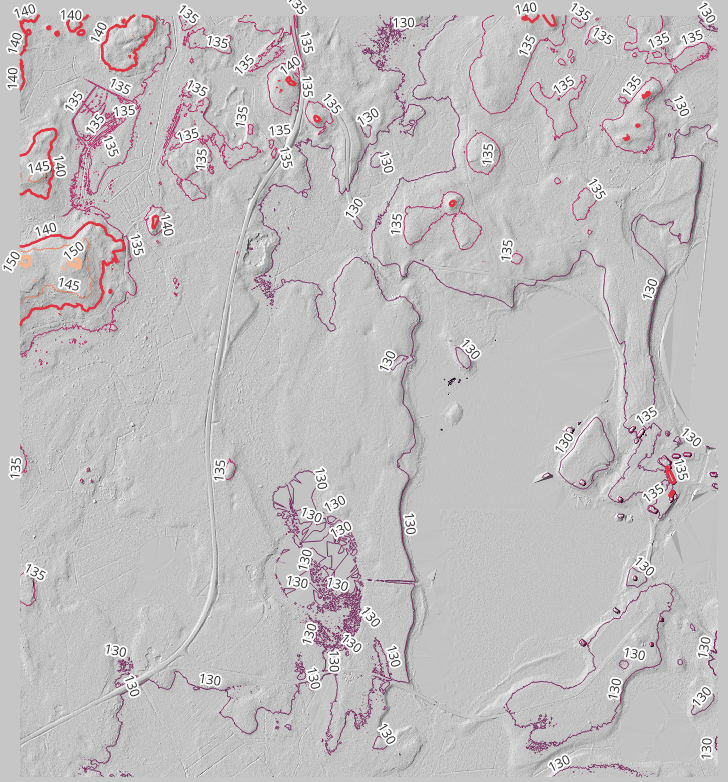

# LiDAR Terrain Analysis
## Forest Drainage & Conservation

### Project Overview

This project explores the application of Light Detection and Ranging (LiDAR) data to terrain modeling, forest drainage interpretation, and conservation-oriented spatial analysis.

Using QGIS and PDAL-based point-cloud processing, classified elevation data is transformed into a digital elevation model (DEM), hillshade visualization, and terrain contours.

The resulting geospatial products support the identification and interpretation of subtle terrain features, including drainage pathways and surface depressions that may be difficult to distinguish beneath forest vegetation.

The project demonstrates how high-resolution elevation modeling can contribute to environmental assessment, forest management, and conservation planning.

### Featured Visualization



*Hillshade visualization derived from the terrain elevation model, revealing surface relief and potential drainage features.*

## Research Objectives

- Process LiDAR point-cloud data into usable terrain information.
- Generate a digital elevation model representing ground elevation.
- Visualize terrain relief and identify potential forest drainage features.
- Generate elevation contours for interpreting terrain morphology.
- Evaluate how derived terrain information can support forest conservation and land-management decisions.

## Technologies and Tools

| Technology | Application |
|------------|-------------|
| QGIS | Geospatial processing, analysis, and visualization |
| PDAL | LiDAR point-cloud processing and classification filtering |
| GDAL | Raster processing and terrain visualization |
| GRASS GIS | Terrain contour generation |
| LAZ | Compressed LiDAR point-cloud data |
| GeoTIFF | Digital elevation model and derived raster storage |
| EPSG:3067 | ETRS89 / TM35FIN projected coordinate reference system |

## Analytical Workflow

### 1. LiDAR Point-Cloud Processing

LiDAR point-cloud data provides three-dimensional measurements of the landscape, including ground and above-ground features.

Ground-classified points are used to develop a terrain representation suitable for subsequent elevation analysis.



*Ground-classified point-cloud visualization used in terrain reconstruction.*

### 2. Digital Elevation Model Generation

The classified point cloud is processed using QGIS's PDAL integration to produce a digital elevation model.

The resulting raster provides a continuous terrain elevation surface that supports topographic interpretation and additional spatial analysis.



*Digital elevation model generated from the ground-classified LiDAR data.*

### 3. Terrain Relief and Drainage Interpretation

Hillshade visualization enhances subtle elevation changes by simulating illumination across the terrain surface.

This representation helps reveal:

- Surface depressions and drainage channels
- Terrain transitions and local relief
- Potential pathways of surface-water accumulation
- Landscape features relevant to forest management

The observed terrain features provide a basis for drainage interpretation rather than a validated hydrological flow model.

### 4. Elevation Contour Generation

Terrain contours are generated using GRASS GIS processing tools.

Contours provide an additional representation of surface elevation and terrain morphology, supporting interpretation of local relief, slope transitions, and drainage-related features.



*Contour visualization highlighting elevation-related terrain features.*

## Conservation Applications

LiDAR-derived terrain information can support environmental decision-making in forested landscapes.

Potential applications include:

**Forest Drainage Assessment**

Identifying depressions, drainage features, and terrain relationships that may influence surface-water movement.

**Habitat and Wetland Conservation**

Providing terrain context for evaluating areas potentially affected by drainage modification, water accumulation, or changing environmental conditions.

**Forest Infrastructure Planning**

Supporting preliminary consideration of access routes, maintenance activities, and terrain constraints while reducing unnecessary disturbance.

**Environmental Monitoring**

Establishing elevation-based reference information that can support future landscape assessments and conservation studies.

## Results and Interpretation

The project demonstrates a connected LiDAR terrain-processing workflow, progressing from ground-classified point-cloud data to elevation modeling, hillshade visualization, and contours.

Together, these products provide complementary representations of forest terrain and improve the visibility of features relevant to drainage interpretation.

The resulting spatial information establishes a foundation for further conservation-oriented analysis.

Detailed hydrological modeling, field validation, and ecological assessment would be required before making operational land-management recommendations.

## Project Structure

```text
lidar_terrain_processing/
├── README.md
├── .gitattributes
├── forest_drainage_conservation.qgz
├── images/
│   ├── ground_classified.png
│   ├── ground_dem_pdal.png
│   ├── hillshade.png
│   └── GRASS_counter.png
├── lidar/
├── rasters/
└── GRASS/
```

The project directory separates point-cloud data, raster outputs, GRASS processing deliverables, and cartographic images.

## Technical Problem-Solving

The terrain-processing workflow involved resolving compatibility and configuration issues across multiple geospatial processing tools.

Key considerations included:

- Distinguishing PDAL filtering expressions from QGIS expression syntax.
- Resolving processing output paths and temporary-file issues.
- Verifying generated outputs independently of processing completion messages.
- Using native QGIS/PDAL functionality to complete DEM generation without requiring proprietary LAStools licensing.
- Maintaining valid data dependencies during project reorganization.

These experiences demonstrate practical geospatial troubleshooting, workflow validation, and analytical problem-solving.

## Future Applications

- Hydrological flow-direction and accumulation modeling
- Drainage-network extraction and validation
- Terrain-based identification of potential wetland areas
- Environmental constraints and conservation suitability analysis
- Integration with forest inventory and land-cover datasets

## Key Skills Demonstrated

- LiDAR point-cloud processing
- Digital elevation model generation
- Ground classification filtering
- Raster terrain analysis
- Hillshade and contour visualization
- Geospatial data management
- QGIS, PDAL, GDAL, and GRASS integration
- Geospatial troubleshooting and workflow validation
- Environmental and conservation-oriented spatial analysis

## Project Status

**LiDAR terrain processing completed; conservation application presented as an exploratory case study.**

The project demonstrates terrain-derived observations and analytical capabilities, not a field-validated forest drainage or hydrological assessment.

## Author

**CJ | GNSS-GLOBAL**

Data & Geospatial Analyst  
FAA Part 107 Certified Remote Pilot

[LinkedIn](https://www.linkedin.com/in/christiann-l-118662184/) | [GitHub](https://github.com/GNSS-GLOBAL)
